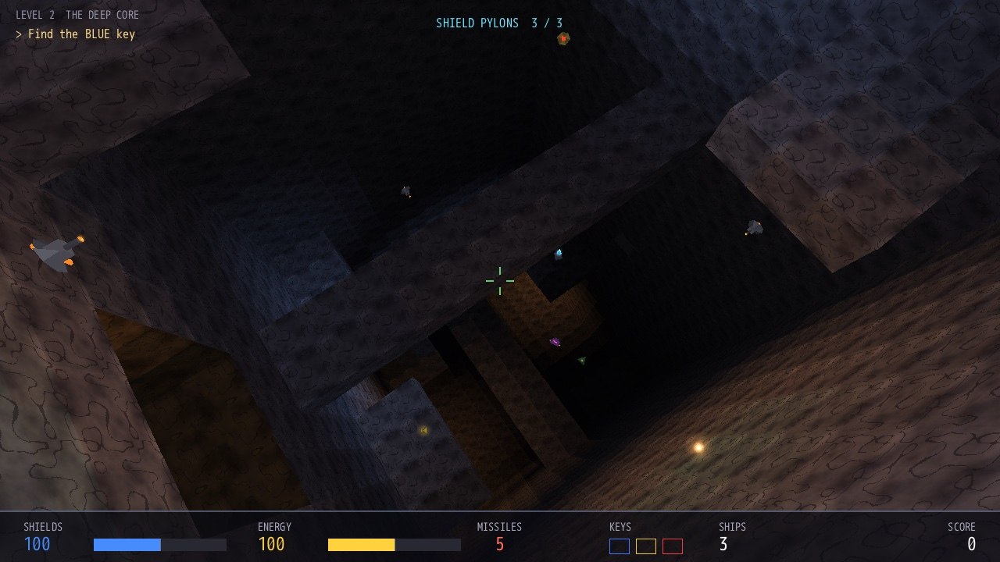
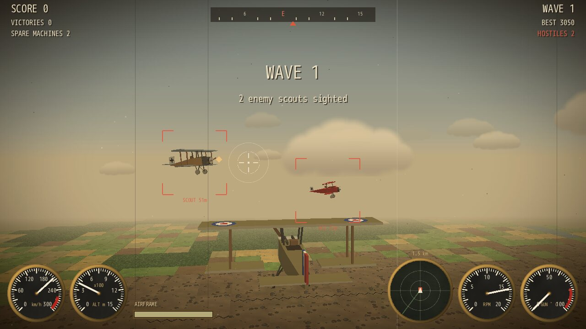
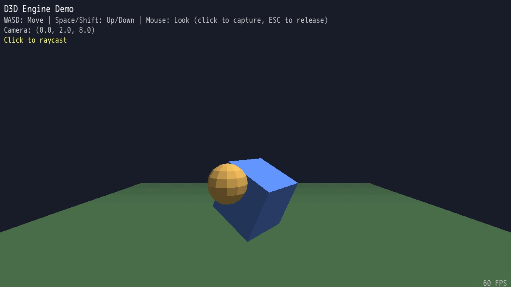
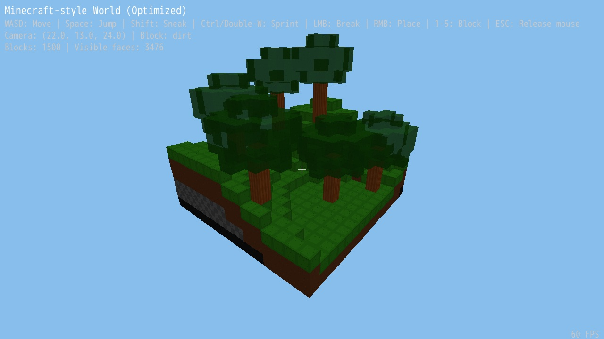
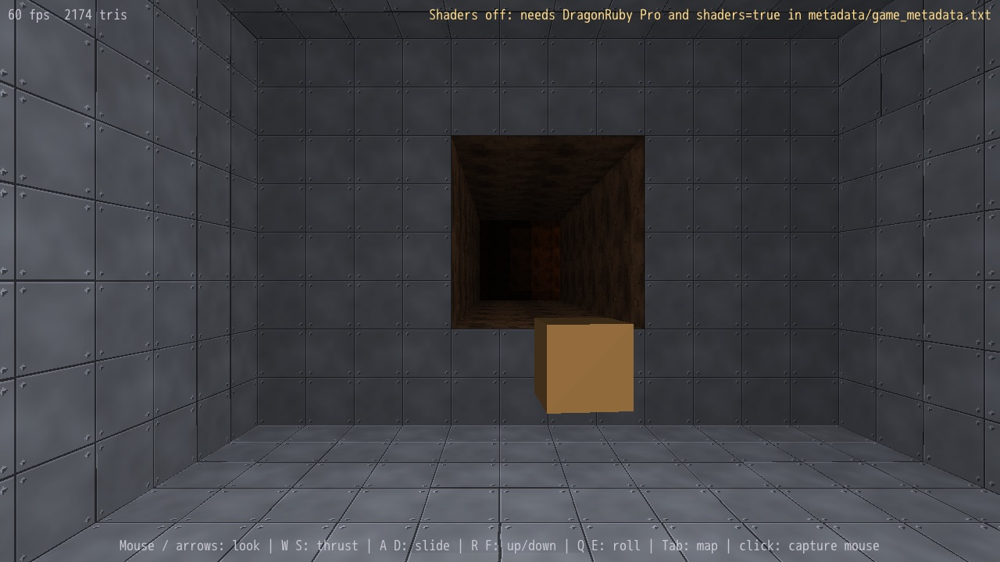
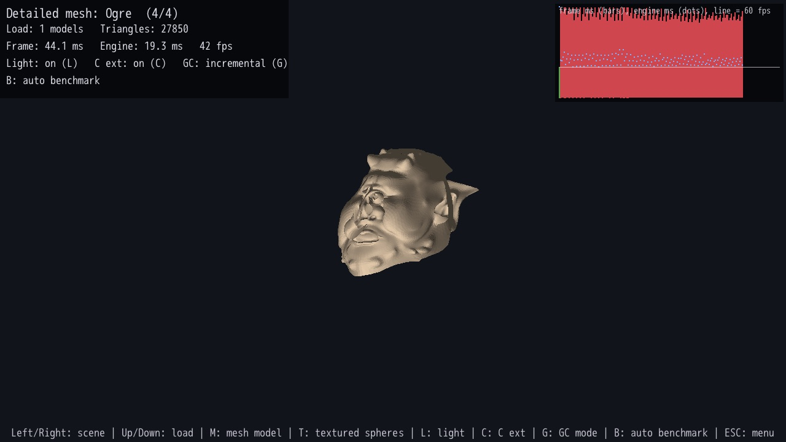

# D3D - 3D Engine for DragonRuby GTK

A lightweight, pure Ruby 3D rendering engine built for [DragonRuby Game Toolkit](https://dragonruby.org/). D3D provides software-rendered 3D graphics with support for models, voxel worlds, textures, and collision detection.

## Games built with D3D

| [Core Breach](https://github.com/webmatze/core_breach) | [Sky Aces 1917](https://github.com/webmatze/sky_aces_1917) |
|---|---|
| [](https://github.com/webmatze/core_breach) | [](https://github.com/webmatze/sky_aces_1917) |
| A six-degrees-of-freedom mine shooter in the style of the mid-90s tunnel shooters, built on the cell-grid renderer. | A Great War dogfighting game over a generated Western Front, built on the 6DOF scene renderer. |

## Features

- **3D Model Rendering** - Render textured or colored 3D models with full transformation support
- **Voxel World System** - Minecraft-style block-based worlds with optimized mesh generation
- **Texture Support** - UV-mapped textures for both models and voxel blocks
- **Camera System** - First-person camera with mouse look and WASD movement
- **Collision Detection** - Ray-triangle, ray-model, and sphere-model collision tests
- **Voxel Character Physics** - AABB bodies with gravity and axis-by-axis collision resolution (VoxelBody)
- **Voxel Raycasting** - Fast DDA raycast for block selection and placement
- **OBJ Loading** - Import 3D models from Wavefront OBJ files
- **Primitive Meshes** - Built-in cube, sphere, and plane mesh generators
- **Optimized Rendering** - Backface culling before projection, near-plane clipping, frustum culling, and depth sorting
- **Lighting and Fog** - Optional flat directional light and distance fog for models and voxel worlds
- **Cell-Grid Scenes (6DOF)** - Cube-cell worlds (mines, dungeons, tunnels) with portal flood-fill culling, near-plane clipping, fog, headlight and coloured point lights, flat-shaded meshes, glow billboards, sphere collision and a wireframe automap

## Demos

Run `dragonruby .` in this repository to open an in-game menu listing all included demos (currently a basic 3D models demo, a Minecraft-style voxel world, a 6DOF cell-grid mine with optional full-screen HLSL post effects, and a performance benchmark). Navigate with the arrow keys, start with Enter or a number key, and press ESC (with a free mouse) to return to the menu.

| | |
|---|---|
|  |  |
| **Basic 3D Models**: lit primitives and raycast picking | **Minecraft World**: textured voxel terrain, player physics, block breaking and placing |
|  |  |
| **Cell Grid Mine + Post-FX**: 6DOF flight through a textured mine (shown without the shaders) | **Performance Benchmark**: Jerry the Ogre, a detailed OBJ mesh, with frame timing |

The **Performance Benchmark** demo stresses the engine with four scenes of adjustable load: rotating spheres, a textured voxel terrain, a cell-grid cavern with point lights, and detailed OBJ meshes (Blub, 14k triangles, and Jerry the Ogre, 40k triangles; see `models/README.md`). It shows frame time, engine time (the render call alone) and triangles with a frame time graph; light and the optional C extension can be toggled live. `B` runs the auto benchmark, which raises the load of every scene until the median frame time no longer fits 60 fps and lists the highest load that did. Frame time includes DragonRuby's own drawing of the triangles, so it is always higher than the engine time.

The mine's post effects need DragonRuby Pro 7.16+ and `shaders=true` in `metadata/game_metadata.txt`. Smaug regenerates that file on `smaug run`/`build` and drops the flag, so start the game with `bin/run` (sets the flag, then launches the DragonRuby version from `Smaug.toml`). Shaders only post-process the finished image (the engine itself stays pure Ruby); without shader support the demo shows the plain mine. `bench/` switches shaders off for its headless runs, because the SDL_GPU renderer that shaders need can't start with SDL's dummy video driver.

To add your own demo, create a class in `app/examples/` with `self.title`, `setup(args)` and `tick(args)`, register it with `Demos.register(MyDemo)` at the bottom of the file, and require it in `app/main.rb`.

## Installation

1. Copy the `app/d3d` folder into your DragonRuby project's `app` directory
2. Require the engine in your `main.rb`:

```ruby
require 'app/d3d/d3d.rb'
```

To keep the engine somewhere else (e.g. vendored into `lib/d3d`), define `D3D_ROOT` before requiring it:

```ruby
D3D_ROOT = 'lib/d3d'
require 'lib/d3d/d3d.rb'
```

The cell-grid renderer also needs two small textures: a white square and a radial glow. Copy `sprites/d3d/` into your game, or pass your own paths with `white_path:` / `glow_path:`.

## Quick Start

### Basic 3D Scene

```ruby
def tick(args)
  setup(args) if args.tick_count == 0

  # Update camera
  args.state.camera.first_person_movement(args)
  args.state.camera.first_person_look(args)

  # Animate cube
  args.state.cube.rotation.y += 0.01
  args.state.cube.mark_dirty!

  # Render
  args.outputs.primitives << D3D.render(args.state.camera, args.state.models)
end

def setup(args)
  # Create camera
  args.state.camera = D3D::Camera.new(
    position: D3D::Vec3.new(0, 2, 8),
    fov: 70
  )

  # Create a cube
  args.state.cube = D3D::Model.new(
    mesh: D3D.cube_mesh,
    color: { r: 100, g: 150, b: 255, a: 255 }
  )
  args.state.cube.set_scale(2)

  # Create ground plane
  args.state.ground = D3D::Model.new(
    mesh: D3D.plane_mesh(width: 20, depth: 20),
    color: { r: 80, g: 120, b: 80, a: 255 }
  )
  args.state.ground.position.y = -1.5

  args.state.models = [args.state.cube, args.state.ground]
end
```

### Voxel World (Minecraft-style)

```ruby
def tick(args)
  setup(args) if args.tick_count == 0

  args.state.camera.first_person_movement(args)
  args.state.camera.first_person_look(args)

  args.outputs.primitives << D3D.render_voxel_world(args.state.camera, args.state.world)
end

def setup(args)
  args.state.camera = D3D::Camera.new(
    position: D3D::Vec3.new(8, 10, 20),
    fov: 70
  )

  # Create voxel world
  args.state.world = D3D::VoxelWorld.new

  # Add blocks with colors
  10.times do |x|
    10.times do |z|
      color = { r: 86, g: 152, b: 59, a: 255 }  # Grass green
      args.state.world.add_block(x, 0, z, color)
    end
  end

  # Build the mesh (required after adding blocks)
  args.state.world.build_mesh
end
```

### Textured Voxel Blocks

```ruby
# Add blocks with textures
args.state.world.add_block(x, y, z,
  { r: 255, g: 255, b: 255, a: 255 },  # Color tint
  texture: "sprites/blocks/grass.png"
)

# Rebuild mesh after modifications
args.state.world.rebuild!
```

### Voxel Character Physics

```ruby
# VoxelBody is an AABB character body for a VoxelWorld: it applies gravity
# and resolves collisions axis by axis. Position is the feet center, in blocks.
body = D3D::VoxelBody.new(8, 20, 8, width: 0.6, height: 1.8)

def tick(args)
  body = args.state.body

  # Set horizontal velocity from input; gravity is applied inside move
  body.velocity.x = 2.0
  body.velocity.z = 0.0
  body.move(args.state.world, 1.0 / 60.0)  # dt in seconds

  # Follow the body with the camera (eye at head height)
  args.state.camera.position = D3D::Vec3.new(
    body.position.x, body.position.y + body.height, body.position.z
  )

  # body.on_ground is true while standing on a block (e.g. to allow jumping)
end
```

### Voxel Raycasting (Block Picking)

```ruby
# Cast a ray from the camera into the voxel world to find the block hit
hit = args.state.world.raycast(camera.position, camera.forward, 8.0)

if hit
  # Remove the block that was hit...
  args.state.world.remove_block(hit[:x], hit[:y], hit[:z])

  # ...or place a block against the hit face using its surface normal:
  # nx, ny, nz = hit[:normal]
  # args.state.world.add_block(hit[:x] + nx, hit[:y] + ny, hit[:z] + nz,
  #   { r: 200, g: 200, b: 200, a: 255 })

  args.state.world.rebuild!
end
```

### Loading OBJ Models

```ruby
# Load a model from OBJ file
mesh = D3D.load_obj("models/spaceship.obj")

model = D3D::Model.new(
  mesh: mesh,
  texture: "sprites/spaceship.png",
  color: { r: 255, g: 255, b: 255, a: 255 }
)
model.set_scale(0.5)
model.position = D3D::Vec3.new(0, 1, 0)
```

### Raycasting / Picking

```ruby
if args.inputs.mouse.click
  # Get ray direction from mouse position
  ray_dir = args.state.camera.screen_to_ray(
    args.inputs.mouse.x,
    args.inputs.mouse.y
  )

  # Test against all models
  hit = D3D::Collisions.ray_models(
    args.state.camera.position,
    ray_dir,
    args.state.models
  )

  if hit
    puts "Hit #{hit[:model]} at distance #{hit[:t]}"
    puts "Hit point: #{hit[:point]}"
  end
end
```

### Sphere Collision

```ruby
# Check if a sphere collides with any model
collisions = D3D::Collisions.sphere_models(
  player_position,  # Vec3 center
  0.5,              # radius
  args.state.models
)

collisions.each do |collision|
  # Push player out of collision
  push_vector = collision[:normal] * collision[:penetration]
  player_position = player_position + push_vector
end
```

## Cell-Grid Scenes (6DOF)

A second, independent rendering path for worlds built from cube cells, such as mine tunnels and dungeons, flown with full six degrees of freedom. It's used by the *Cell Grid Mine + Post-FX* demo (`app/examples/postfx_demo.rb`), the cavern scene of the benchmark demo and by the games [Core Breach](https://github.com/webmatze/core_breach) and [Sky Aces 1917](https://github.com/webmatze/sky_aces_1917). It works with plain `[x, y, z]` arrays (`D3D::V`) instead of `Vec3`, because its hot loops can't afford the allocations.

```ruby
def setup
  @grid = D3D::CellGrid.new(24, 12, 30, cell_size: 10.0)
  @grid.carve(3, 8, 3, 6, 2, 7, :metal, [1.0, 1.0, 1.05])   # i, j, k ranges, material, light tint
  @grid.carve(5, 6, 4, 5, 8, 14, :rock, [0.8, 0.7, 0.6])
  @grid.rebuild_faces

  @renderer = D3D::SceneRenderer.new(
    focal: 620, fog: 140,
    materials: { metal: { path: 'sprites/metal.png', size: 128 },
                 rock:  { path: 'sprites/rock.png',  size: 128 } }
  )
  @pose = D3D::Pose.new([55.0, 45.0, 30.0], [0.0, 0.0, 1.0])   # position, forward
  @crate = D3D::FlatMesh.new.box(0, 0, 0, 2, 2, 2, [200, 150, 80])
end

def tick(args)
  @pose.yaw!(0.01).roll!(0.002).orthonormalize!
  @grid.collide_sphere(@pose.position, 2.4)                    # push out of walls

  lights = [{ pos: [60.0, 40.0, 60.0], radius: 40, color: [1.0, 0.5, 0.2], intensity: 0.9 }]
  @renderer.begin_frame(@pose, lights: lights)
  @renderer.draw_grid(@grid)
  @renderer.draw_mesh(@crate, [60.0, 40.0, 60.0], [1, 0, 0], [0, 1, 0], [0, 0, 1])
  @renderer.draw_glow([60.0, 40.0, 60.0], 6.0, 255, 140, 60)
  @renderer.flush(args.outputs)
end
```

### How it works

- **World (`CellGrid`)**
  - A 3D grid of open or solid cells. Rooms are carved as boxes, and `roughen` makes caverns less boxy.
  - A wall quad is generated wherever an open cell touches a solid one. Each quad stores a corner, two edge vectors, an inward normal, its material and a tint. The tint is shaded per direction: floors brighter, ceilings darker.
  - `seal`/`unseal` turn cells into blockers, e.g. doors, whose neighbours' faces use the blocker's material.
  - At runtime, `unseal` and `solidify` (e.g. a cave-in) rebuild only the faces of the changed cell and its 6 neighbours, and bump `version` so `GridMap` knows to redraw.
- **Camera (`Pose`)**
  - A position plus orthonormal right/up/forward vectors, rotated around its own axes (`yaw!`, `pitch!`, `roll!`). No gimbal lock, full roll.
  - World to camera space is three dot products; projection is `640 + x·f/z`.
- **Visibility**
  - `CellGrid#visible_cells` flood-fills from the camera's cell through open cells.
  - It only crosses a cell boundary ("portal") that lies within fog distance and inside the view frustum. The frustum test is 4 corners against 5 planes, with corner positions cached per frame.
- **Walls (`SceneRenderer#draw_face`)**
  1. Backface cull and a whole-face frustum reject.
  2. Distance-based subdivision (up to 4×4) hides DragonRuby's affine texture warping.
  3. Sutherland–Hodgman near-plane clipping, which interpolates texture coordinates.
  4. Fan triangulation, then ~0.7 px seam padding to close hairline cracks.
- **Lighting**
  - Per sub-quad: tint × fog, plus a camera headlight, plus coloured point lights with linear falloff, plus an optional global ambient boost.
  - The result is applied as the sprite's `r/g/b` tint over the texture.
- **Objects**
  - `FlatMesh` models (per-triangle colour, auto-outward winding, double-sided and emissive flags) are flat shaded with a headlight-style Lambert term.
  - `draw_glow` draws additive camera-facing billboards.
- **Sorting**
  - Everything goes into one list keyed by squared distance, sorted back to front (painter's algorithm).
  - To stop objects showing through walls, only draw them when `CellGrid#los?` from the camera reaches them.
- **Automap (`GridMap`)**
  - Records the cells the renderer found visible near the camera.
  - Draws their wall outlines as 3D lines, skipping edges where a wall continues flat, with an orbit camera and depth fading.
  - Colours come from an `edge_color: ->(cell, blocker_tag) { [r, g, b] }` callable.

### Cell-grid API

| Class | Key methods |
|---|---|
| `D3D::V` | `add sub scale madd dot cross len dist dist2 norm lerp rotate_pair basis_from_forward random_unit`; also `D3D.clamp`, `D3D::Lcg` (deterministic RNG) |
| `D3D::Pose` | `new(position, fwd, up_hint)`, `position right up fwd`, `look!(fwd)`, `yaw!/pitch!/roll!(rad)`, `orthonormalize!`, `dup` |
| `D3D::CellGrid` | `new(nx, ny, nz, cell_size:)`, `carve fill roughen rebuild_faces`, `rebuild_faces_near(n)`, `solidify(i, j, k)` (runtime cave-ins), `version` (bumped on runtime changes), `seal(i,j,k, tag, material:) unseal(n) blocker_near(pos, r) blocker_index(tag) blockers`, `open? solid_at? cell_of cell_center idx coords tint_of tint_at`, `los?(a, b)`, `collide_sphere(pos, r)`, `visible_cells(renderer)`, `faces` |
| `D3D::SceneRenderer` | `new(width:, height:, focal:/fov:, near:, fog:, view_distance:, fog_mode: (:linear / :exponential), headlight_range:, headlight:, materials:, white_path:, glow_path:)`, `begin_frame(pose, lights:, ambient_boost:)`, `draw_grid(grid)`, `draw_face(face)`, `draw_mesh(mesh, pos, right, up, fwd, scale, light, flash)`, `draw_glow(pos, size, r, g, b, a)`, `project(pos)`, `sorted_primitives`, `flush(outputs)`, `triangle_count`, `last_visible` |
| `D3D::FlatMesh` | `vert`, `tri(a, b, c, color, inside:, double_sided:, emissive:)`, `quad`, `box(cx, cy, cz, sx, sy, sz, color, side_color)`, `bipyramid(sides, r, front, back, colors, axis:)` |
| `D3D::GridMap` | `new(grid, edge_color:, explore_radius:)`, `explore(cells, cam_pos)`, `open(pose)`, `update(inputs)`, `lines(pose, markers)`, `render(outputs, pose, markers)`, `explored?(pos)` |

`fog` and `view_distance` are separate: `view_distance` (default: `fog`) is how far cells and meshes are drawn, `fog` how quickly they darken. `fog_mode: :linear` (default) goes black at `fog`; `:exponential` darkens about as quickly near the camera but only fades out (~20% brightness left at `fog`, ~4% at twice that), so a `view_distance` beyond `fog` shows far cells slowly disappearing into the dark.

## API Reference

### D3D Module

```ruby
D3D.render(camera, models, light: nil, fog: nil)            # Render models
D3D.render_voxel_world(camera, voxel_world, light: nil, fog: nil)
# light: { direction: [x, y, z], ambient: 0.35 }  flat shading, direction points towards the light
# fog:   { near:, far:, color: [r, g, b] }        blends towards color, skips triangles beyond far
#        (textures are tinted, so fog on textured faces only looks right towards dark colours)
D3D.load_obj(path)                           # Load OBJ file
D3D.cube_mesh                                # Create cube mesh
D3D.plane_mesh(width:, depth:, segments_x:, segments_z:)
D3D.sphere_mesh(radius:, segments:, rings:)
```

### Camera

```ruby
camera = D3D::Camera.new(
  position: D3D::Vec3.new(0, 0, 0),
  fov: 70,
  near: 0.1,
  far: 1000
)

camera.look_at(target_vec3)           # Point camera at target
camera.first_person_movement(args)    # WASD + Space/Shift movement
camera.first_person_look(args)        # Mouse look (click to capture)
camera.screen_to_ray(screen_x, screen_y)  # Get ray from screen point

camera.forward  # Direction vector
camera.right    # Right vector
camera.up       # Up vector
```

### Model

```ruby
model = D3D::Model.new(
  mesh: mesh,
  texture: "path/to/texture.png",  # Optional
  texture_size: 64,                # Optional: pixels (Integer or [w, h]); by default
                                   # the image size DragonRuby reports
  color: { r: 255, g: 255, b: 255, a: 255 }
)

model.position = D3D::Vec3.new(x, y, z)
model.rotation = D3D::Vec3.new(rx, ry, rz)  # Radians
model.set_scale(uniform_scale)
model.set_scale(sx, sy, sz)
model.translate(dx, dy, dz)
model.rotate(drx, dry, drz)
model.visible = true/false
model.mark_dirty!  # Call after changing transform
```

### VoxelWorld

```ruby
world = D3D::VoxelWorld.new

world.add_block(x, y, z, color, texture: nil)
world.remove_block(x, y, z)
world.has_block?(x, y, z)
world.get_block(x, y, z)
world.block_count
world.build_mesh   # Generate renderable mesh
world.rebuild!     # Force mesh regeneration
world.raycast(origin, dir, max_distance)    # DDA voxel raycast -> hit hash or nil
world.aabb_intersects?(min_vec3, max_vec3)  # Does an AABB overlap any block?
```

### VoxelBody

```ruby
# AABB character body for a VoxelWorld (position = feet center, in block units)
body = D3D::VoxelBody.new(x, y, z,
  width: 0.6,
  height: 1.8,
  gravity: 32.0,
  terminal_velocity: -78.0
)

body.velocity = D3D::Vec3.new(vx, vy, vz)
body.move(world, dt)                         # gravity + axis-by-axis collision
body.move(world, dt, prevent_falling: true)  # also refuse walking off ledges

body.on_ground          # standing on a block?
body.position           # feet position (Vec3)
body.aabb_min           # AABB corners (Vec3)
body.aabb_max
body.colliding?(world)  # currently overlapping a block?
```

### Vec3

```ruby
v = D3D::Vec3.new(x, y, z)

v + other      # Addition
v - other      # Subtraction
v * scalar     # Scalar multiply
v / scalar     # Scalar divide
v.dot(other)   # Dot product
v.cross(other) # Cross product
v.length       # Magnitude
v.normalize    # Unit vector
v.distance_to(other)
v.lerp(other, t)

# Constants
D3D::Vec3.zero
D3D::Vec3.one
D3D::Vec3.up
D3D::Vec3.forward
D3D::Vec3.right
```

### Collisions

```ruby
# Ray-triangle intersection
hit = D3D::Collisions.ray_triangle(origin, direction, v0, v1, v2)

# Ray-model intersection
hit = D3D::Collisions.ray_model(origin, direction, model)

# Ray against multiple models
hit = D3D::Collisions.ray_models(origin, direction, models)

# Sphere-model collision
collision = D3D::Collisions.sphere_model(center, radius, model)

# Sphere against multiple models
collisions = D3D::Collisions.sphere_models(center, radius, models)

# AABB intersection test
D3D::Collisions.aabb_intersects?(min1, max1, min2, max2)

# Sphere-sphere intersection
D3D::Collisions.sphere_intersects_sphere?(c1, r1, c2, r2)
```

## Controls (Default First-Person)

| Key | Action |
|-----|--------|
| W/Up | Move forward |
| S/Down | Move backward |
| A/Left | Strafe left |
| D/Right | Strafe right |
| Space | Move up |
| Shift | Move down |
| Mouse Click | Capture mouse for look |
| Escape | Release mouse |

## Project Structure

```
app/
  d3d/
    d3d.rb         # Main module, entry point
    vec3.rb        # 3D vector math
    mat4.rb        # 4x4 matrix operations
    mesh.rb        # Mesh data structure + primitives
    model.rb       # 3D model with transform
    camera.rb      # Camera and projection
    renderer.rb    # Triangle rasterization
    obj_loader.rb  # Wavefront OBJ parser
    collisions.rb  # Collision detection
    voxel_world.rb # Voxel/block world system
    voxel_body.rb  # AABB character physics for voxel worlds
    v.rb              # Array-based vector helpers, clamp, Lcg
    pose.rb           # 6DOF position + orientation basis
    cell_grid.rb      # Cube-cell world: faces, collision, LOS, blockers, portal visibility
    scene_renderer.rb # Cell-grid / mesh / glow renderer with clipping and lighting
    depth_sort.rb     # Back-to-front sort (fastest variant per VM, C when loaded)
    native.rb         # Optional C extension loader (D3D::Native)
    ext/d3d_ext.c     # C extension source (D3D Pro only, bin/build-ext)
    flat_mesh.rb      # Flat shaded mesh builder
    grid_map.rb       # Wireframe automap of explored cells
  examples/
    basic_demo.rb     # Basic 3D models demo
    minecraft_demo.rb # Minecraft-style voxel demo
    postfx_demo.rb    # 6DOF cell-grid mine, HLSL post-processing shader with Pro
    perf_demo.rb      # Performance benchmark: stress scenes + auto benchmark
  demo_registry.rb # Demo registry + in-game menu
  main.rb          # Entry point (requires + Demos.tick)
bench/             # Headless benchmark suite (see bench/README.md)
tests/             # Minitest unit tests for the pure-Ruby engine
sprites/
  blocks/          # Voxel textures
  d3d/             # white.png + glow.png used by SceneRenderer
  cell_grid/       # Wall textures for the cell-grid demo
shaders/postfx/    # HLSL fragment shader for the mine's post effects
models/            # Detailed OBJ meshes for the benchmark (public domain, see README)
docs/screenshots/  # README screenshots of the demos and games
```

## Optional C Extension (D3D Pro)

D3D is pure Ruby and runs with any DragonRuby license. D3D Pro adds a small C
extension (DragonRuby Indie or Pro to ship it, Standard loads it in dev mode
only) that takes over hot spots: the
back-to-front depth sort (~50x faster in C), the per-face loops of models
(textured or not) and of voxel worlds (culling, transform, light, fog;
65-84% less time per render call in DragonRuby, e.g. a 14k-triangle mesh
22.4 -> 5.1 ms, a textured 32x32 voxel terrain 8.7 -> 1.7 ms) and the wall
faces and portal visibility of cell grids (subdivision, lighting with
point lights; a cell grid frame drops from ~7.4 to ~0.9 ms). The rare
triangles crossing the near plane are still clipped by the Ruby code.

D3D Pro is a one-time purchase on [itch.io](https://webmatze.itch.io/d3d-pro): prebuilt libraries for
macOS, Linux and Windows plus the C source. Copy its `native/` folder into your
game, or unzip the whole package into a D3D checkout of the same version to
also get `bin/build-ext` and `bench/native_check.rb`.

```ruby
require 'app/d3d/d3d.rb'
D3D::Native.load   # true when the extension is active, false otherwise
```

Nothing changes for games that skip this: `D3D::Native.load` returns `false`
without a license that allows C extensions, without a built library or on CRuby, and every native
function has a pure Ruby fallback with identical output
(`ruby bench/native_check.rb` compares both inside DragonRuby).
`D3D::Native.enabled = false` switches back to Ruby at runtime. A library
built for another D3D version is refused (with a warning) instead of being
called with the wrong arguments.

## Testing

The pure-Ruby engine parts have unit tests that run with system Ruby (no DragonRuby required):

```bash
for f in tests/*.rb; do ruby "$f"; done
```

## Benchmarks

A headless benchmark suite measures the engine's Ruby-side cost across rendering,
math, voxel, and physics paths, comparing each run to a committed baseline so
optimization work can be checked for real improvements vs. noise:

```bash
ruby bench/bench.rb            # run all cases, compare to the baseline
ruby bench/bench.rb --save     # write the current results as the new baseline
ruby bench/bench.rb --json     # machine-readable output
```

See [`bench/README.md`](bench/README.md) for the full workflow and caveats.

## Performance Tips

1. **Minimize block changes** - Call `build_mesh` only when needed, not every frame
2. **Use frustum culling** - The renderer automatically culls off-screen geometry
3. **Reduce polygon count** - Use lower segment counts for spheres when possible
4. **Batch similar objects** - Group models with the same texture when possible
5. **Use `mark_dirty!`** - Only call on models whose transforms changed
6. **Switch mruby's GC to incremental mode** - Put
   `GC.generational_mode = false` at the top of your `main.rb`. With large
   meshes loaded (e.g. a 40k-triangle OBJ), DragonRuby's default generational
   GC ran a full collection about every 8th frame, a ~17 ms hitch each time;
   incremental mode had none and rendered 13-15% faster even without large
   meshes. The engine doesn't change the GC mode itself; the demos do.

## License

MIT License - See LICENSE file for details. The C extension (D3D Pro) is
sold separately under a commercial license.

## Credits

Built for [DragonRuby Game Toolkit](https://dragonruby.org/)
